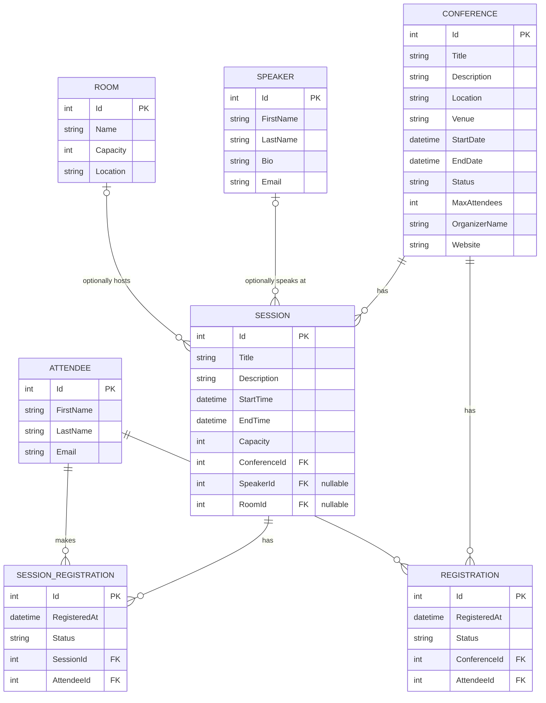

# Entity-relationship diagram

Relationship notes:
- `Conference` 1—* `Session` via `Session.ConferenceId` (required — a session always belongs to a conference).
- `Conference` 1—* `Registration` via `Registration.ConferenceId` (required).
- `Speaker` 0/1—* `Session` via `Session.SpeakerId` (optional — a session can have no speaker).
- `Room` 0/1—* `Session` via `Session.RoomId` (optional).
- `Attendee` 1—* `Registration` via `Registration.AttendeeId` (required). Attendees are deduplicated by `Email` in `RegistrationService`, so one `Attendee` can have registrations across multiple conferences.
- `Session` 1—* `SessionRegistration` via `SessionRegistration.SessionId` (required). `Status` is `"CONFIRMED"`, `"CANCELLED"` (soft-delete on cancel), or `"WAITLISTED"` (joined after the session reached capacity); counts/lookups filter on `"CONFIRMED"` for registered totals and `"WAITLISTED"` for the waitlist. Cancelling a `"CONFIRMED"` row promotes the earliest `"WAITLISTED"` row (by `RegisteredAt`, tiebreak `Id`) to `"CONFIRMED"`.
- `Attendee` 1—* `SessionRegistration` via `SessionRegistration.AttendeeId` (required). Attendees are deduplicated by `Email` (trimmed, case-insensitive) in `SessionRegistrationService`.
